<div align="center">

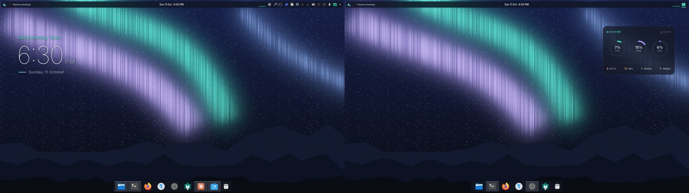

# ☾ Nocturne

**An ink-navy & aurora-mint theme for KDE Plasma 6 — desktop, login screen and terminal, all from one palette.**

`#090c13` ink · `#3ddbb5` aurora mint · `#b49cff` violet · Inter + JetBrains Mono Nerd Font

</div>

---

## What you get

| | |
|---|---|
| **Colours** | KDE colour scheme, Breeze widgets/decorations recoloured, GTK 3/4 + libadwaita (GNOME apps) + Flatpak |
| **Panels** | floating translucent top bar per screen (launcher, active window, date + 12-hour clock, CPU sparkline, media, tray) and a dock per screen that dodges windows |
| **Widgets** | *Nocturne Clock* — greeting, big clock, date · *Nocturne Stats* — live CPU/RAM/GPU rings, temperature, disk, network |
| **Screens** | splash screen, frosted lock screen, a themed **logout / restart / shutdown** confirmation, and an SDDM **login screen** |
| **Icons** | Papirus-Dark with teal folders (generated, no system files touched) · crescent-moon logo |
| **Terminal** | Konsole profile, Starship prompt (pills, git status, durations, transient prompt), ble.sh colours |
| **CLI tools** | themes for bat, fzf, eza + LS_COLORS, atuin, btop, git-delta, lazygit, yazi, fastfetch (custom logo) |
| **Neovim** | Nocturne colourscheme + a lean lazy.nvim config (fzf-lua, LSP via Mason, completion, git signs, lualine) |
| **Wallpaper** | a generated aurora night sky (included, MIT) — or bring your own with `--wallpaper` |

<table>
<tr><td>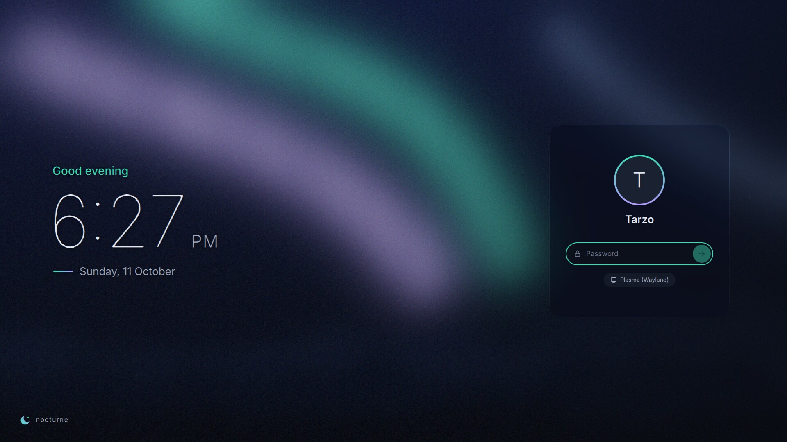</td><td>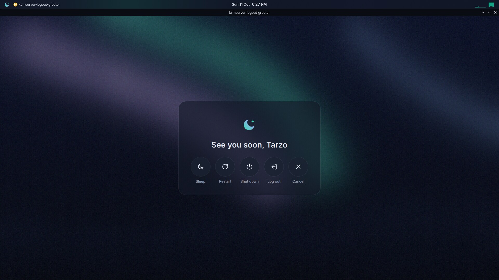</td></tr>
<tr><td align="center">Login screen</td><td align="center">Logout / restart / shutdown</td></tr>
<tr><td>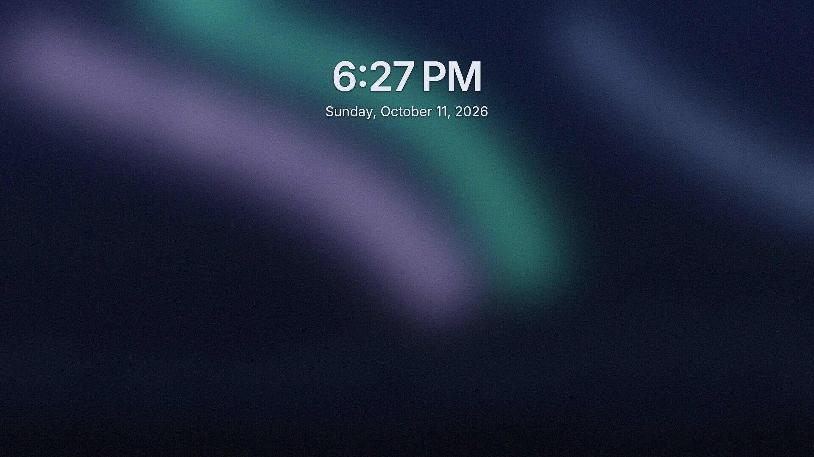</td><td>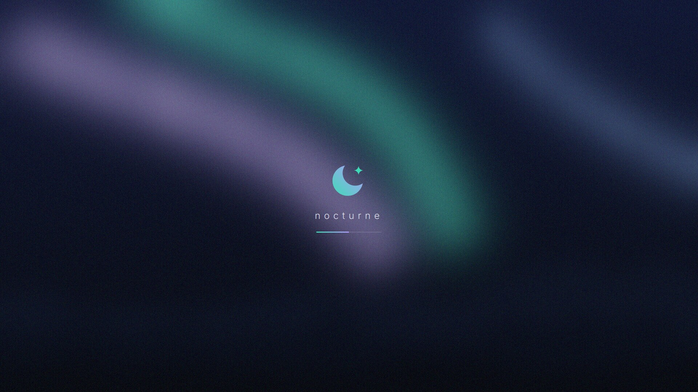</td></tr>
<tr><td align="center">Lock screen (frosted)</td><td align="center">Splash</td></tr>
<tr><td>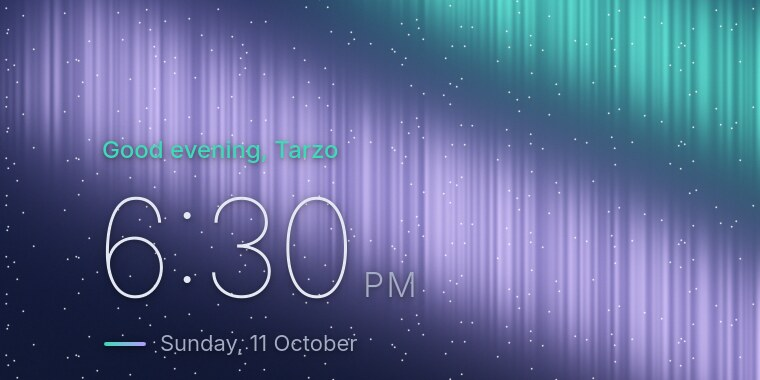</td><td>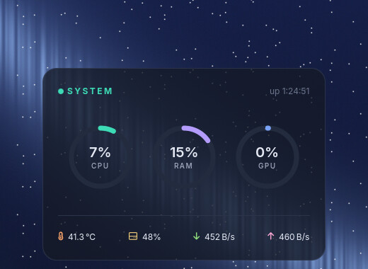</td></tr>
<tr><td align="center">Nocturne Clock</td><td align="center">Nocturne Stats</td></tr>
<tr><td>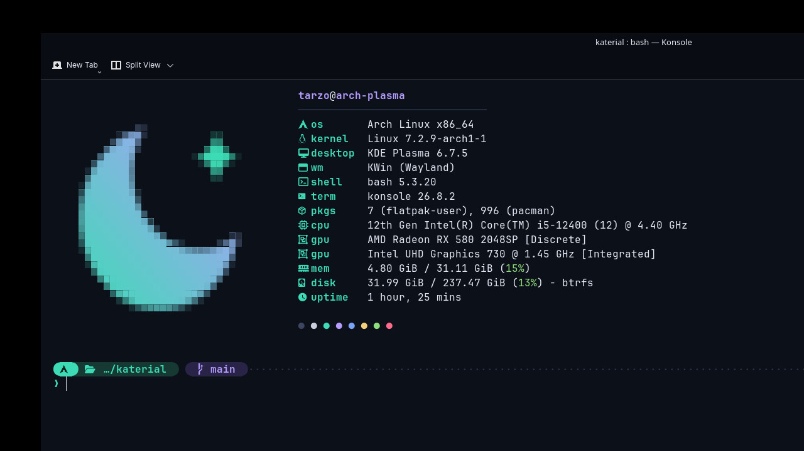</td><td>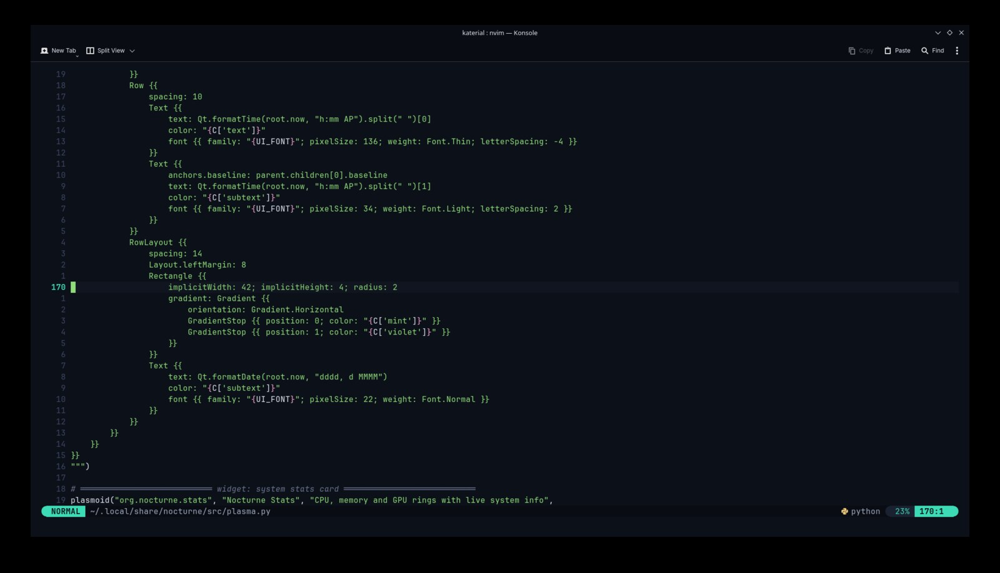</td></tr>
<tr><td align="center">Prompt + fastfetch</td><td align="center">Neovim</td></tr>
<tr><td>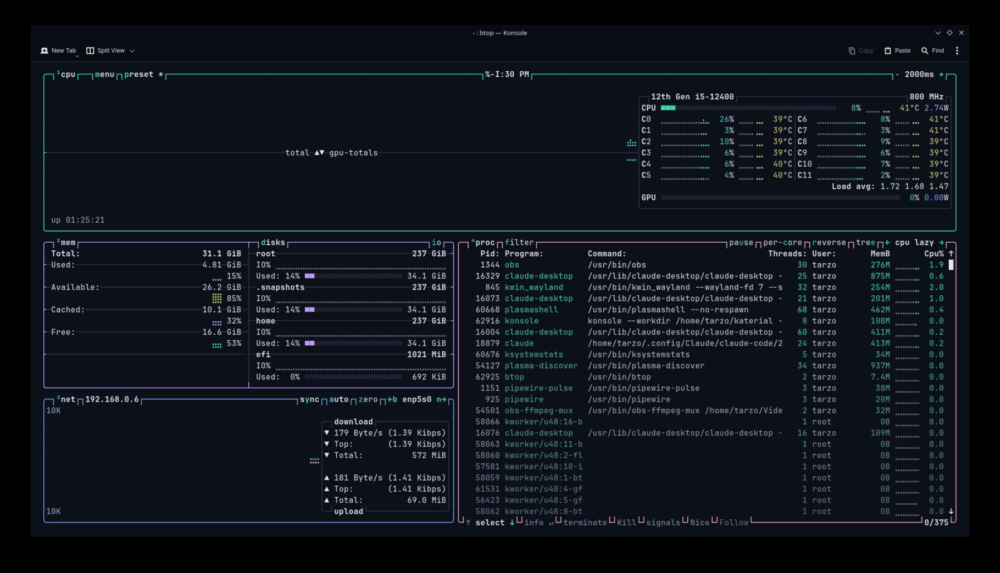</td><td>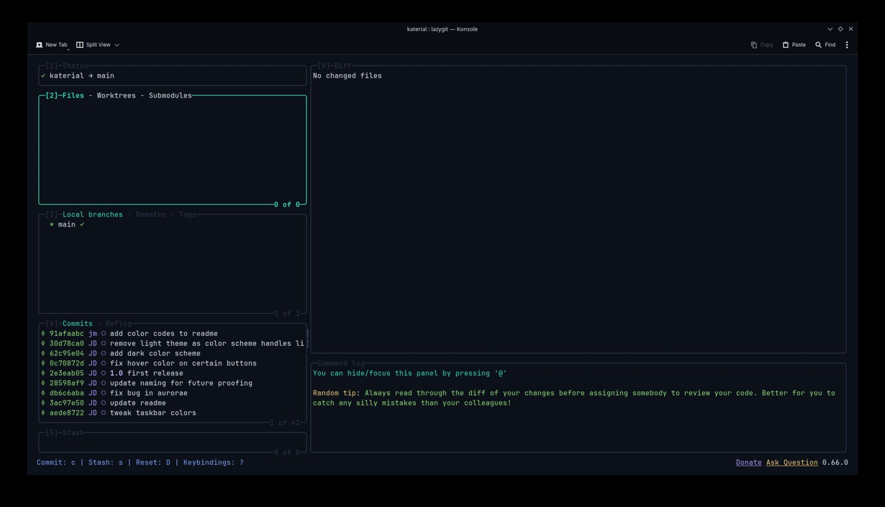</td></tr>
<tr><td align="center">btop</td><td align="center">lazygit</td></tr>
<tr><td>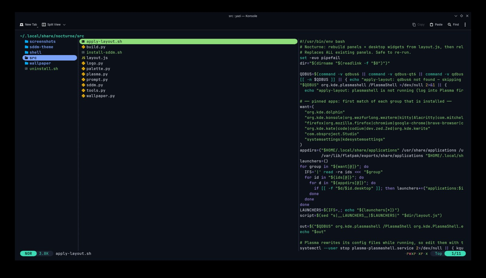</td><td>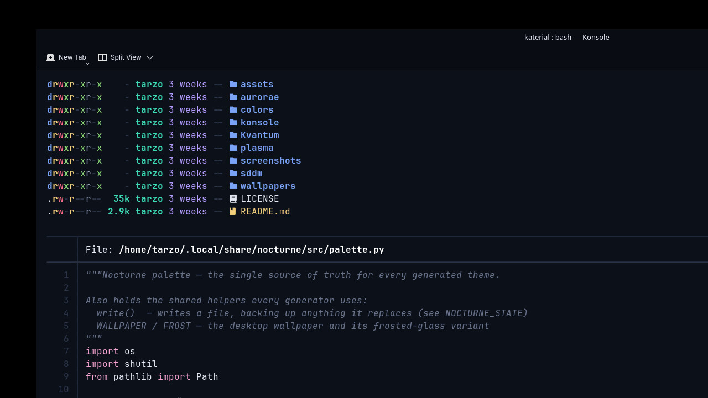</td></tr>
<tr><td align="center">yazi</td><td align="center">eza + bat</td></tr>
<tr><td>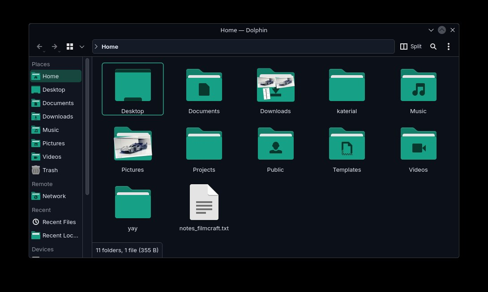</td><td>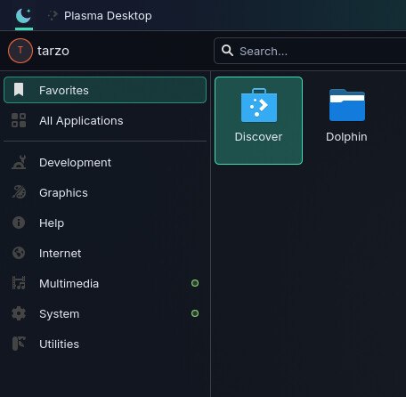</td></tr>
<tr><td align="center">Dolphin + teal folders</td><td align="center">Launcher</td></tr>
</table>

## Install

```bash
git clone https://github.com/tarzo-codes/nocturne-kde.git
cd nocturne-kde
./install.sh
```

The installer asks before each big step (installing packages, replacing your panels, installing the
login screen with `sudo`). Everything else lands in your home directory.

| option | does |
|---|---|
| `-y`, `--yes` | answer yes to everything (non-interactive) |
| `--no-deps` | don't install packages, use what you already have |
| `--no-layout` | keep your current panels and desktop widgets |
| `--no-sddm` | don't install the login screen |
| `--no-shell` | don't touch `~/.bashrc` |
| `--shell-only` | only the terminal side (prompt, CLI themes, nvim) — no desktop changes |
| `--wallpaper IMG` | use your own wallpaper; lock/login/splash/logout get a frosted version of it |

### Requirements

- **KDE Plasma 6** (Wayland or X11). On anything else the installer automatically switches to `--shell-only`.
- `python3`, and **ImageMagick** for the wallpaper, frosted backgrounds and fastfetch logo.
- Login screen: **SDDM 0.21+** with the Qt6 greeter (`sddm-greeter-qt6`).
- Packages are installed for you on **Arch, Debian/Ubuntu, Fedora and openSUSE**; anything missing from your
  repos is skipped and listed. On Arch, [ble.sh](https://github.com/akinomyoga/ble.sh) is offered from the AUR
  if `paru`/`yay` is available. JetBrains Mono Nerd Font is downloaded from the
  [Nerd Fonts](https://github.com/ryanoasis/nerd-fonts) release if it isn't packaged for you.

### What the installer takes care of

- **Backs up** every file it changes on the first run (`~/.local/state/nocturne/backup`) and records every file it
  creates, so the uninstaller can put things back exactly. Re-running the installer is safe and keeps the original backup.
- **Never overwrites** an existing Neovim config — the colourscheme is just added (`:colorscheme nocturne`).
- **`.bashrc`**: adds one clearly marked block (placed *before* `ble-attach` if you use ble.sh) instead of replacing your file.
- Works with **any number of monitors and resolutions**; pinned dock apps are picked from what's installed
  (Dolphin, your terminal, your browser, your editor, OBS, System Settings).
- Missing tools are fine: every part of the shell setup is optional, Debian's `batcat`/`fdfind` are linked as `bat`/`fd`,
  and without Papirus the theme falls back to Breeze Dark icons.
- Not logged into Plasma (TTY/SSH)? Settings are written and apply at your next login — run `nocturne layout` then.
- If `/etc/sddm.conf` pins a theme it is backed up to `/etc/sddm.conf.bak-nocturne`; otherwise a drop-in is used.

## After installing: the `nocturne` command

```text
nocturne rebuild            regenerate everything from the palette and re-apply colours
nocturne layout             rebuild the top bars, docks and desktop widgets
nocturne wallpaper <image>  switch wallpaper (frosted backgrounds follow)
nocturne sddm               (re)install the login screen
nocturne edit               open the palette in $EDITOR, then rebuild
nocturne uninstall          remove Nocturne and restore your previous settings
```

### Make it yours

Every colour comes from [`src/palette.py`](src/palette.py). Change a value, run `nocturne rebuild`, and the KDE
colours, GTK, Konsole, prompt, CLI tools, Neovim, widgets, splash, logout and login screens all follow
(`nocturne sddm` to push the login screen).

| file | generates |
|---|---|
| `src/build.py` | KDE colour scheme, Konsole, GTK 4 / libadwaita — and runs everything below |
| `src/prompt.py` | Starship prompt |
| `src/tools.py` | bat, fzf, eza, LS_COLORS, atuin, btop, delta, lazygit, yazi, fastfetch, nvim colours, ble.sh faces |
| `src/plasma.py` | wallpaper + frost, icons, widgets, splash, logout screen, global theme, fonts, KWin settings |
| `src/sddm.py` | the SDDM login theme |
| `src/layout.js` | panel + widget layout (Plasma scripting) |

## Shell cheat-sheet

| key / command | does |
|---|---|
| `Ctrl-R` | atuin history search |
| `Ctrl-T` / `Alt-C` / `**<Tab>` | fzf: files (bat preview), directories (tree preview), completion |
| `z foo`, `zi` | zoxide jump |
| `y` | yazi file manager, cd to where you quit |
| `ls ll la lt` | eza with icons and git status |
| `cat` | bat without the pager · `man` pages are coloured too |
| `lg` `top` `calc` `ff` | lazygit · btop · eva · fastfetch |

Neovim (leader = Space): `␣f` files · `␣/` grep · `␣b` buffers · `␣g` git status · `-` file browser · `:Mason` language servers.

## Uninstall

```bash
nocturne uninstall      # or: ~/.local/share/nocturne/uninstall.sh
```

Restores the settings backed up at install time, removes every file Nocturne created, strips the block from
`~/.bashrc`, and (with `sudo`) removes the login screen and restores `/etc/sddm.conf`. Log out and back in afterwards.

## Credits & license

MIT — see [LICENSE](LICENSE). Built on KDE Plasma, Breeze, [Papirus](https://github.com/PapirusDevelopmentTeam/papirus-icon-theme),
[Inter](https://rsms.me/inter/), [Nerd Fonts](https://www.nerdfonts.com/), [Starship](https://starship.rs) and
[ble.sh](https://github.com/akinomyoga/ble.sh). The bundled wallpaper is generated by `src/wallpaper.py`.
